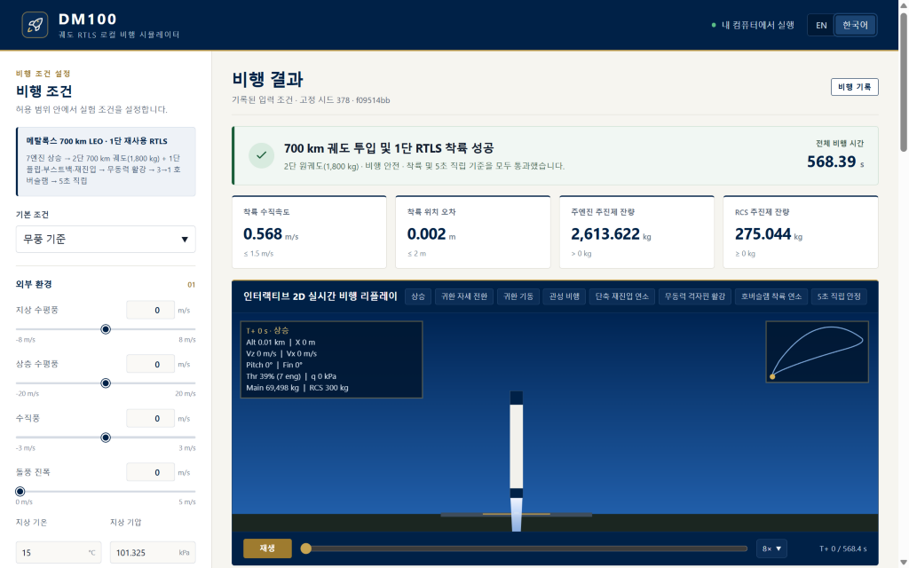

# DM100 · 100톤 메탈록스 700 km 원궤도 발사 및 1단 재사용 RTLS

[English](README.md) | [검증 결과](docs/results.ko.md) | [모델 명세](docs/spec.ko.md) | [검증 설계](docs/validation.ko.md) | [실행 환경](docs/runtime.ko.md) | [로드맵](docs/roadmap.ko.md)

총질량 **100톤 2단 메탈록스(LCH₄/LOX) 로켓**의 발사, 고고도 콜드 단 분리, **2단 700 km 원궤도(1,800 kg 탑재체) 투입**, 그리고 <strong>1단 재사용 발사장 귀환(RTLS)</strong>을 통합 계산하는 **2차원 개념 시뮬레이터**입니다. 7엔진 클러스터 상승과 콜드 분리 뒤, 2단은 구면 지구 2회 연소(천이 + 원지점 원궤도화)로 700 km 원궤도를 적분·판정하고, 1단은 저동압 플립, 3엔진 부스트백, 단축 재진입 연소(MECO-2) 이후 **무동력 격자핀 활강(25.0~43.0 km, 스로틀 명령 0%)**, **3→1엔진 최소 스로틀 수직 호버슬램(Hoverslam)**, 그리고 **접지 후 5초 무동력 착륙다리 접촉·직립 동역학**까지 전 과정을 `Plant ↔ Forces ↔ GNC` 경계가 분리된 단일 엔진으로 모델링합니다.

오프라인 로컬 브라우저 실험 화면은 영어를 기본으로 제공하며 한국어로 전환할 수 있고, **인터랙티브 2D 실시간 리플레이**와 **50 Hz 3D 리플레이 JSON(ENU + 단위 쿼터니언)** 내보내기, 선택적 H.264 MP4 영상 렌더링을 지원합니다.



---

## 핵심 검증 결과

극한 경계 및 100% 동시 최악 조합 **32개 극한 엣지 케이스**, 기존 검증 연구 입력 **169개**(`configs/validation-study-v1.json`), 기존 회귀 스위트 **286개**(`configs/apr-regression-v1.json`)를 단일 병렬 실행으로 검증했습니다([validation-487.json](docs/results/validation-487.json), 상세 분석: [검증 결과 보고서](docs/results.ko.md)).

| 평가 집단 | 통과 / 실행 | 1단 잔여 추진제 (kg) | 최대 위치 오차 (m) | 최대 동압 (kPa) | 최대 각가속도 (deg/s²) | 무동력 활강 (km) | 700 km 궤도 / 5초 직립 |
| :--- | :---: | :---: | :---: | :---: | :---: | :---: | :---: |
| 극한 엣지 케이스 (`edge-cases`) | **32 / 32 (100%)** | 1,749~3,692 | 0.389 | 33.31 | 3.81 | 25.0~32.3 | 32 / 32 · 32 / 32 |
| 개발 조건 (`development`) | **16 / 16 (100%)** | 2,021~3,102 | 0.202 | 30.61 | 3.18 | 27.7~32.9 | 16 / 16 · 16 / 16 |
| 복합 홀드아웃 (`holdout`) | **96 / 96 (100%)** | 1,822~3,146 | 0.901 | 32.24 | 3.15 | 27.3~35.7 | 96 / 96 · 96 / 96 |
| 확장 센서 홀드아웃 (`sensor-holdout`) | **57 / 57 (100%)** | 1,817~3,099 | 0.279 | 31.21 | 3.19 | 26.7~35.3 | 57 / 57 · 57 / 57 |
| 회귀 스위트 (`regression`, 3개 분할 합산) | **286 / 286 (100%)** | 932~3,895 | 1.500 | 33.08 | 3.32 | 26.6~43.0 | 286 / 286 · 286 / 286 |
| **합계** | **487 / 487 (100.0%)** | **932~3,895** | **1.500** | **33.31** | **3.81** | **25.0~43.0** | **487 / 487 · 487 / 487** |

**전 487케이스 제약 여유 요약 (16개 전 제약 × 487건 = 7,792개 검사 전량 ≤ 79.3%, 80% 초과 0건):**
- **2단 700 km 원궤도 (1,800 kg)**: `700.01~703.25 km` (최대 오차 `3.25 km`, 한계 `±15 km`의 `21.7%`), 2단 잔여 추진제 `182.2~918.7 kg`
- **접지 위치 오차**: `0.000~1.500 m` (중앙 **`0.020 m`**, 한계 `≤ 2.0 m`의 **`75.0%`**)
- **다리 끝점 수직 / 수평 속도**: `0.078~1.070 m/s` (`71.3%`) / `0.000~0.360 m/s` (`72.0%`)
- **접지 기울기 / 각속도**: `≤ 2.056°` (`68.5%`) / `≤ 0.301 deg/s` (`60.1%`)
- **최대 동압 / 정체 열유속**: `≤ 33.31 kPa` (`≤ 42 kPa`의 **`79.3%`**) / `≤ 21.05 kW/m²` (`≤ 80 kW/m²`의 **`26.3%`**)
- **최대 상승 / 회수 하중**: `≤ 3.55 g` (`≤ 4.5 g`의 `79.0%`) / `≤ 4.33 g` (`≤ 5.5 g`의 `78.8%`)
- **최대 각속도 / 각가속도 / 핀 힌지**: `≤ 11.11 deg/s` (`74.1%`) / `≤ 3.81 deg/s²` (`76.1%`) / `≤ 1,397 N·m` (`18.6%`)
- **1단 주추진제 / RCS 잔량 중앙값**: **`2,612.8 kg`** (`최소 932.0 kg`) / **`271.9 kg`** (`최소 168.5 kg`, 재점화 `3/3`)
- **5초 무동력 착륙다리 직립**: **487 / 487 (100.0%)** (`다리 압축 ≤ 0.389 m` `43.3%`, `접촉 하중 ≤ 1.66 g` `41.4%`)


대표 시나리오의 50 Hz 3D 리플레이 JSON(UE5·MuJoCo 연동용, ENU 미터 + 단위 쿼터니언 `wxyz`)을 [calm_replay_50hz.json](docs/results/replays/calm_replay_50hz.json) 및 [example_weather_replay_50hz.json](docs/results/replays/example_weather_replay_50hz.json)에 함께 제공합니다.

---

## 시스템 구조 및 핵심 기법

### 물리·유도·제어 아키텍처
- **700 km 궤도 임무 + 8단계 RTLS 시퀀스**: `ascent → flip → boostback → coast → entry_burn → aero_glide → landing_burn → touchdown_settle` + 2단 구면 지구 700 km 원궤도 적분(`rtls/orbit.py`)
- **결합 물리 모델**: 가변 질량·관성, 역방향 하강 둔체 항력($C_{D,\text{descent}} = 1.65$), Sutton-Graves 정체 열유속($\dot{q} \le 80\ \text{kW/m}^2$), 격자핀 초음속·아음속 유효 받음각 및 힌지 모멘트 한계($\le 7{,}500\ \text{N}\cdot\text{m}$), **7기 메탈록스 클러스터(엔진당 최소 스로틀 36%, 최대 재점화 3회, 7→3→1)**, 추진제 공급 버퍼·폐쇄 헬륨 가압·비선형 슬로시·운동량 보존 콜드 분리 충격량, **접지 후 5초 스프링-댐퍼·쿨롱 마찰 착륙다리 동역학**
- **인과적 항법·자세 추정**: 잡음, 편향, 관측/명령 지연, 엔진 응답 지연, 예정된 센서 패킷 누락 하의 인과적 추정기(미래 관측·숨겨진 실제 상태 미사용)
- **강인 RTLS 유도 및 제어 할당 (전 제약 ≤ 80% 안전 여유)**:
  - 재진입 연소 `0.85 s` 점화 스로틀 램프 및 동압·열유속 이중 트리거(`26.5 kPa`, `62 kW/m²`)로 진공 슬로시 충격 제거
  - 초음속 고고도(`z ≥ 27 km`) 격자핀 받음각 상한(`5°`)과 저고도(`z < 12 km`) 고이득 활강 유도 + 인과적 온라인 항력·밀도 배율 추정(`_predict_rtls_iip`)
  - 유한 각가속도 복귀 변위를 해석적으로 적분하는 제로-틸트 예측기(`_predict_zero_tilt_state`)와 저역통과 필터링된 수평 가속도 편향(`bias_x`)
  - 수직 정렬 진입 `0.28 s` 각가속도 램프, 거리 인식형 종말 수평 제동, 볼록 LP 종말 참조 플래너 및 우선순위 제어 할당(`격자핀 → TVC 짐벌 → RCS`)
- **기술 스택**: Python 3.12, NumPy/SciPy, FastAPI/Uvicorn, HTML/CSS/JS, Matplotlib/FFmpeg. 명시적 물리·GNC 모델을 사용하며 **머신러닝 정책을 학습하지 않습니다.**

### 기체 제원 및 판정 기준

| 항목 | 모델 값 |
| :--- | :---: |
| 총 발사 질량 / 1단 초기 질량 | 100,000 / 76,000 kg |
| 1단 건조 / 주 추진제(LCH₄·LOX) / RCS 질량 | 6,200 / 69,500 / 300 kg |
| 2단 건조 / 주 추진제 / 탑재체 질량 | 1,550 / 20,650 / 1,800 kg |
| 1단 치수 (길이 / 직경) | 25.5 m / 3.1 m |
| 1단 7기 클러스터 해면 / 진공 추력 | 1,550 / 1,693 kN |
| 1단 해면 / 진공 비추력 | 325 / 355 s |
| 2단 진공 추력 / 진공 비추력 | 240 kN / 380 s |
| 추력 조절 / 엔진 재점화 / 짐벌 | 엔진당 최소 36% (7→3→1) / 최대 3회 / ±6° |
| 2단 목표 궤도 판정 기준 | 700 ± 15 km 원궤도 (1,800 kg, 잔여 추진제 > 0 kg) |
| 비행 안전 한계 | 동압 ≤ 42 kPa, 열유속 ≤ 80 kW/m², 상승 ≤ 4.5 g, 회수 ≤ 5.5 g, 각가속도 ≤ 5.0°/s², 핀 힌지 ≤ 7,500 N·m |
| 접지 판정 기준 (최초 접지) | 위치 오차 ≤ 2.0 m, 수직 ≤ 1.5 m/s, 수평 ≤ 0.5 m/s, 기울기 ≤ 3.0°, 각속도 ≤ 0.5°/s |
| 접지 후 안정화 기준 | 엔진 OFF 5초 착륙다리 직립 유지, 압축 ≤ 0.90 m, 하중 ≤ 4.0 g |

자세한 좌표계, 상태 변수, 운용 범위와 보존 검사는 [모델 명세](docs/spec.ko.md)와 [검증 설계](docs/validation.ko.md)를 참고하세요.

---

## 로컬 실행 및 데모

Windows x64에서는 저장소를 복제하거나 ZIP을 푼 뒤 [launch-dm100.bat](launch-dm100.bat)를 실행합니다. 기존 Python 3.12가 없으면 프로젝트 내부에 Python 3.12.15와 `.venv`를 자동 구성하며, 정상 환경은 네트워크 접속 없이 재사용합니다. 브라우저는 `127.0.0.1`에서 열리며 외부 API나 CDN을 사용하지 않습니다. 상세 호환성은 [실행 환경 안내](docs/runtime.ko.md)를 참고하세요.

```powershell
# Windows x64 원클릭 실행 및 환경 점검
.\launch-dm100.bat
.\launch-dm100.bat --setup-only
.\launch-dm100.bat --doctor

# 수동 설치 및 실행
py -3.12 -m venv .venv
.\.venv\Scripts\python.exe -m pip install -c requirements/runtime-constraints.txt -e ".[ui,video]"
.\.venv\Scripts\python.exe -m powered_landing_guidance.local_app
```

Linux x64(glibc 2.28 이상):

```bash
sh launch-dm100.sh
sh launch-dm100.sh --setup-only
sh launch-dm100.sh --doctor
```

### CLI 비행 실행 및 487케이스 재현

```bash
# 단일 대표 비행 실행 및 50 Hz 3D 리플레이 JSON 내보내기
python scripts/run_flight.py --scenario calm --export-replay artifacts/calm_replay_50hz.json
python scripts/run_flight.py --scenario example-weather --export-replay artifacts/example_weather_replay_50hz.json

# 극한 엣지 32케이스 빠른 검증 또는 전체 487케이스 병렬 검증
python scripts/evaluate_validation.py --suite edge-cases --workers 8
python scripts/evaluate_validation.py --suite full-487 --workers 14 --out-json artifacts/validation-487.json
```

CPU `float64` 연산을 사용하며, 다중 프로세스 실행 시 `OPENBLAS_NUM_THREADS=1`, `OMP_NUM_THREADS=1` 설정을 권장합니다.

---

## 소프트웨어 검증

```bash
python -m pip install -c requirements/runtime-constraints.txt -e ".[ui,video,dev]"
python -m pytest -q -p no:cacheprovider
python -m ruff check --no-cache .
python -m ruff format --check --no-cache .
```

물리 모델, 보존 법칙, 700 km 궤도 투입, RTLS 유도·할당, 추정기 인과성, 50 Hz 리플레이 JSON, 로컬 API 및 UI를 검사합니다(`223 passed, 11 subtests passed`). [Windows·Linux CI](.github/workflows/checks.yml)가 매 커밋마다 소프트웨어 테스트, 검증 JSON 무결성, 실행기 및 패키지를 자동 확인합니다.

---

## 저장소 구성

```text
configs/                          운용, 회귀(286) 및 검증 연구(169) 고정 입력
docs/spec.md, spec.ko.md          영어·한국어 물리 모델 명세
docs/validation.md, validation.ko.md  검증 설계와 재현 명령
docs/results.md, results.ko.md    487케이스 검증 및 ≤80% 여유 달성 보고서
docs/roadmap.ko.md                2D Orbital RTLS → 3D 6DOF MuJoCo → UE5 확장 로드맵
docs/results/                     validation-487.json 및 50 Hz 3D 리플레이 JSON
docs/assets/                      옥스포드 블루 로컬 UI 스크린샷 및 한·영 SVG 시각화 자료
requirements/                     검증한 런타임·개발 의존성 제약 조건
scripts/                          단일 비행 CLI(run_flight.py), 487케이스 평가기(evaluate_validation.py)
src/powered_landing_guidance/     공통 물리, 재사용 RTLS 엔진(rtls/), 2단 궤도 적분기(rtls/orbit.py), 로컬 UI
tests/                            물리, RTLS 유도·제어, 추정기, 로컬 UI 자동 테스트 (223건)
launch-dm100.bat / .sh            Windows·Linux 자동 환경 준비 및 앱 실행기
```

---

## 적용 범위 및 한계

이론적 소프트웨어 2차원 개념 모델로 수평·수직 이동과 평면 내 회전, 그리고 2단의 구면 지구 2회 연소 원궤도 투입을 다룹니다. 공력·추진·열·센서 계수는 실물 측정으로 보정하지 않았으며, 유연 구조, 3차원 유체·플룸 상호작용, 재료 강도, 3차원 6자유도(6DOF) 비행과 실기 인증은 범위 밖입니다. 3차원 6자유도 물리(MuJoCo)와 시네마틱 시각화(Unreal Engine 5)는 별도의 신규 3D 저장소에서 이어서 진행합니다([로드맵](docs/roadmap.ko.md)).
