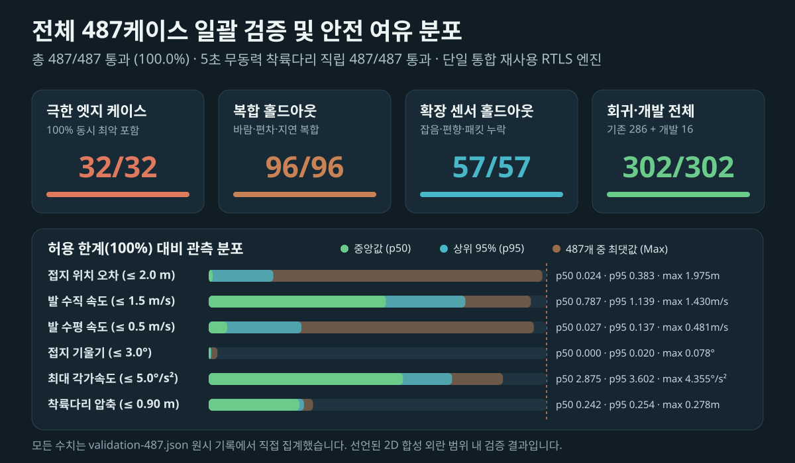
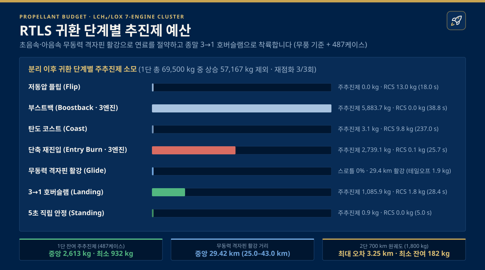
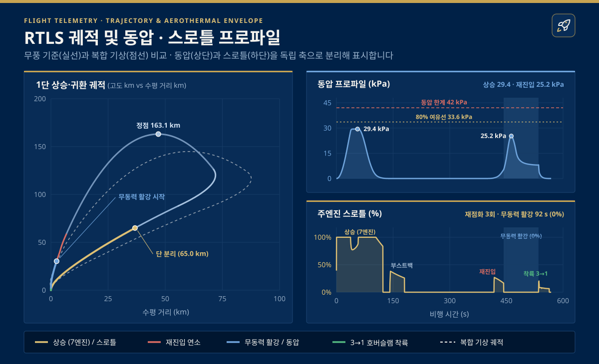

# DM100 - 2차원 재사용 RTLS 로켓 발사와 1단 재사용 귀환

[English](README.md) | [검증 결과](docs/results.ko.md) | [모델 명세](docs/spec.ko.md) | [검증 설계](docs/validation.ko.md) | [로드맵](docs/roadmap.ko.md)

총질량 100톤 2단 로켓의 발사, 약 37 km에서의 콜드 단 분리, 그리고 **RTLS(재사용 발사체)
방식의 1단 발사장 귀환(RTLS)**을 계산하는 **2차원 개념 시뮬레이터**입니다.
분리 직후 저동압 플립, 부스트백 연소, 짧은 재진입 연소(MECO-2) 뒤
**무동력 격자핀 활강(9.6–14.5 km, 스로틀 명령 0%)**, **3→1엔진 최소 스로틀
수직 호버슬램(Hoverslam)**, 그리고 **접지 후 5초 무동력 착륙다리 접촉·직립
안정성 동역학**까지 전 과정을 `Plant ↔ Forces ↔ GNC` 경계가 분리된 단일 엔진으로
모델링합니다.

오프라인 로컬 브라우저 실험 화면은 영어를 기본으로 제공하며 한국어로 전환할 수 있고,
**인터랙티브 2D 실시간 리플레이**와 **50 Hz 3D 리플레이 JSON(ENU + 단위 쿼터니언)**
내보내기, 선택적 H.264 MP4 영상 렌더링을 지원합니다.


실제 실행 화면은 영어 UI로 촬영했으며, 앱 오른쪽 위에서 한국어로 전환할 수 있습니다.

## 구현한 물리·유도·제어 기능

- **7단계 재사용 RTLS 비행**: `ascent → flip → boostback → coast → entry_burn → aero_glide → landing_burn → touchdown_settle`
- **물리 모델**: 가변 질량·관성, 역방향 하강 둔체 항력($C_{D,\text{descent}} = 1.65$),
  격자핀 유효 받음각 및 힌지 모멘트 한계, **3기 엔진 클러스터(엔진당 최소 스로틀 44%,
  최대 재점화 3회)**, 단순화한 추진제 공급·가압·슬로싱·단 분리 충격량 모델,
  **접지 후 5초 스프링-댐퍼·쿨롱 마찰 착륙다리 동역학**
- **인과적 항법·자세 추정**: 잡음, 편향, 관측/명령 지연, 엔진 응답 지연, 예정된 센서
  패킷 누락 하의 인과적 추정기(미래 관측·숨겨진 실제 상태 미사용)
- **강인 RTLS 유도 및 제어 할당**:
  - 무동력 활강 중 인과적 가속도 바이어스로부터 대기 항력·밀도 배율을 실시간 추정하는
    온라인 IIP 예측기(`_predict_rtls_iip`)
  - 유한 각가속도(`2.15 deg/s²`) 복귀 변위를 해석적으로 적분하는 제로-틸트 예측기
    (`_predict_zero_tilt_state`)
  - 3엔진 Stage A 전환 선행 예측 + 1엔진 Stage B 잔여 시간 기반 무오버슈트 속도 상한
  - 잡음 내성 결정론적 수직 정렬 래치(`h ≤ 21.5 m`), 짐벌 스텝 제한 및 구간 일치형
    우선순위 제어 할당(격자핀 → TVC 짐벌 → RCS), 볼록 최적화(LP) 종말 참조 플래너
- **도구 및 인터페이스**: Python 3.12, NumPy/SciPy, FastAPI/Uvicorn, HTML/CSS/JS,
  Matplotlib/FFmpeg. 명시적 물리·GNC 모델을 사용하며 **머신러닝 정책을 학습하지 않습니다.**

## 전체 487케이스 검증 결과

극한 경계 및 100% 동시 최악 조합 **32개 극한 엣지 케이스**, 기존 검증 연구 입력
**169개**(`configs/validation-study-v1.json`), 기존 회귀 스위트 **286개**
(`configs/apr-regression-v1.json`)를 단일 병렬 실행으로 검증했습니다
([validation-487.json](docs/results/validation-487.json), 상세 분석: [검증 결과 보고서](docs/results.ko.md)).

| 평가 집단 | 통과 / 실행 | 주추진제 잔량 (kg) | 최대 위치 오차 (m) | 최대 동압 (kPa) | 최대 각가속도 (deg/s²) | 무동력 활강 (km) | 5초 직립 |
|---|---:|---:|---:|---:|---:|---:|---:|
| 극한 엣지 케이스 (`edge-cases`) | **32 / 32 (100%)** | 9,343 – 10,287 | 1.766 | 29.61 | 4.32 | 9.6 – 14.3 | 32 / 32 |
| 개발 조건 (`development`) | **16 / 16 (100%)** | 9,505 – 10,020 | 0.313 | 28.37 | 3.61 | 11.4 – 13.6 | 16 / 16 |
| 복합 홀드아웃 (`holdout`) | **96 / 96 (100%)** | 9,294 – 10,172 | 0.610 | 29.44 | 4.21 | 11.2 – 13.6 | 96 / 96 |
| 확장 센서 홀드아웃 (`sensor-holdout`) | **57 / 57 (100%)** | 9,406 – 10,113 | 0.436 | 28.99 | 4.14 | 11.2 – 13.6 | 57 / 57 |
| 회귀 스위트 (`regression`, 3개 분할 합산) | **286 / 286 (100%)** | 9,385 – 10,301 | 1.975 | 28.96 | 4.36 | 10.5 – 14.5 | 286 / 286 |
| **합계** | **487 / 487 (100.0%)** | **9,294 – 10,301** | **1.975** | **29.61** | **4.36** | **9.6 – 14.5** | **487 / 487** |

전 487케이스 지표 요약:
- **접지 위치 오차**: `0.000–1.975 m` (중앙값 **`0.024 m`**, 한계 `≤ 2.0 m`)
- **발 수직 / 수평 속도**: `0.159–1.430 m/s` (`≤ 1.5`) / `0.000–0.481 m/s` (`≤ 0.5`)
- **접지 기울기 / 각속도**: `≤ 0.078°` (`≤ 3.0°`) / `≤ 0.147 deg/s` (`≤ 0.5 deg/s`)
- **최대 각가속도 / 동압 / 회수 하중**: `≤ 4.36 deg/s²` (`≤ 5.0`) / `≤ 29.61 kPa` (`≤ 30.0`) / `≤ 4.86 g` (`≤ 5.0`)
- **주추진제 / RCS 잔량 중앙값**: **`9,772.0 kg`** / **`252.2 kg`** (재점화 `3/3`)
- **5초 무동력 착륙다리 직립**: **487 / 487 (100.0%)** (`다리 압축 ≤ 0.278 m`, `접촉 하중 ≤ 1.98 g`)







대표 시나리오의 50 Hz 3D 리플레이 JSON(UE5·MuJoCo 연동용, ENU 미터 + 단위 쿼터니언 `wxyz`)을
[calm_replay_50hz.json](docs/results/replays/calm_replay_50hz.json) 및
[example_weather_replay_50hz.json](docs/results/replays/example_weather_replay_50hz.json)에
함께 제공합니다.

## 로컬 브라우저 실행

Windows x86-64에서는 저장소를 복제하거나 ZIP을 푼 뒤 [launch-dm100.bat](launch-dm100.bat)를
실행합니다. 기존 Python 3.12가 없으면 프로젝트 내부에 Python 3.12.15와 `.venv`를
자동 구성하며, 정상 환경은 네트워크 접속 없이 재사용합니다.
브라우저는 `127.0.0.1`에서 열리며, 터미널에서 `Ctrl+C`로 종료합니다.
상세 환경 호환성은 [실행 환경 안내](docs/runtime.ko.md)를 참고하세요.

```powershell
# 실행 환경만 준비하거나 폰트·영상 인코더 상태를 점검합니다.
.\launch-dm100.bat --setup-only
.\launch-dm100.bat --doctor
```

수동 설치 및 실행:

```powershell
py -3.12 -m venv .venv
.\.venv\Scripts\python.exe -m pip install -c requirements/runtime-constraints.txt -e ".[ui,video]"
.\.venv\Scripts\python.exe -m powered_landing_guidance.local_app
```

Linux x86-64(glibc 2.28 이상):

```bash
sh launch-dm100.sh
sh launch-dm100.sh --setup-only
sh launch-dm100.sh --doctor
```

계산, 결과 저장과 영상 생성은 모두 로컬 오프라인 환경에서 수행하며 외부 API나 CDN을
사용하지 않습니다.

1. 프리셋 7종(무풍, 복합 기상, 극한 전단풍·돌풍, 극한 Max-Q, 극한 중량·저추력 등) 또는 사용자 조건을 선택합니다.
2. 비행을 실행한 뒤 **인터랙티브 2D 실시간 리플레이**(재생/일시정지, 타임라인 스크러버, 0.5×–20× 배속, 단계 바로가기, 격자핀·짐벌 플룸·RCS·착륙다리 압축 HUD), `활강·제어` 그래프, RTLS 단계별 연료 분석표, 접지 및 5초 직립 판정표를 확인합니다.
3. 성공한 비행에서 선택적 MP4 영상 렌더링 또는 **50 Hz 3D 리플레이 JSON(`replay_3d.json`)** 다운로드를 수행할 수 있습니다.

## CLI 비행 실행 및 487케이스 재현

```bash
# 단일 대표 비행 실행 및 50 Hz 3D 리플레이 JSON 내보내기
python scripts/run_flight.py --scenario calm --export-replay artifacts/calm_replay_50hz.json
python scripts/run_flight.py --scenario example-weather --export-replay artifacts/example_weather_replay_50hz.json

# 극한 엣지 32케이스 빠른 검증 또는 전체 487케이스 병렬 검증
python scripts/evaluate_validation.py --suite edge-cases --workers 8
python scripts/evaluate_validation.py --suite full-487 --workers 14 --out-json artifacts/validation-487.json
```

CPU `float64` 연산을 사용하며, 다중 프로세스 실행 시 `OPENBLAS_NUM_THREADS=1`,
`OMP_NUM_THREADS=1` 설정을 권장합니다.

## 기체 제원 및 판정 기준

| 항목 | 모델 값 |
|---|---:|
| 발사 질량 / 1단 초기 질량 | 100,000 / 82,500 kg |
| 1단 건조 / 주 추진제 / RCS 질량 | 12,000 / 70,200 / 300 kg |
| 2단 건조 / 추진제 / 탑재체 질량 | 1,500 / 15,500 / 500 kg |
| 해면 / 진공 추력 (3기 클러스터 합산) | 1,600 / 약 1,760 kN |
| 해면 / 진공 비추력 | 300 / 약 330 s |
| 추력 조절 / 엔진 재점화 / 짐벌 | 엔진당 최소 44% (3→1 호버슬램) / 최대 3회 / ±6도 |
| 콜드 분리 조건 | 37 ±1 km, 주 추진제 20,000 kg 이상 |
| 접지 판정 기준 (최초 접지) | 위치 오차 ≤ 2 m, 발 수직 ≤ 1.5 m/s, 발 수평 ≤ 0.5 m/s, 기울기 ≤ 3°, 각속도 ≤ 0.5°/s |
| 접지 후 안정화 기준 | 엔진 OFF 5초 착륙다리 동역학 직립 유지, 압축 ≤ 0.90 m, 하중 ≤ 4.0 g |

자세한 좌표계, 상태 변수, 운용 범위와 보존 검사는 [모델 명세](docs/spec.ko.md)와
[검증 설계](docs/validation.ko.md)를 참고하세요.

## 소프트웨어 검사

```bash
python -m pip install -c requirements/runtime-constraints.txt -e ".[ui,video,dev]"
python -m pytest -q -p no:cacheprovider
python -m ruff check --no-cache .
python -m ruff format --check --no-cache .
```

물리 모델, 보존 법칙, RTLS 유도·할당, 추정기 인과성, 50 Hz 리플레이 JSON,
로컬 API 및 UI를 검사합니다. [Windows·Linux CI](.github/workflows/checks.yml)가
매 커밋마다 소프트웨어 테스트, 검증 JSON 무결성, 실행기 및 패키지를 자동 확인합니다.

## 저장소 구성

```text
configs/                          운용, 회귀(286) 및 검증 연구(169) 고정 입력
docs/spec.md, spec.ko.md          영어·한국어 물리 모델 명세
docs/validation.md, validation.ko.md  검증 설계와 재현 명령
docs/results.md, results.ko.md    487케이스 검증 및 개선 사항 보고서
docs/roadmap.ko.md                2D RTLS → 3D MuJoCo → UE5 확장 로드맵
docs/results/                     validation-487.json 및 50 Hz 3D 리플레이 JSON
docs/assets/                      로컬 UI 스크린샷 및 시각화 자료
requirements/                     검증한 런타임·개발 의존성 제약 조건
scripts/                          단일 비행 CLI(run_flight.py), 487케이스 평가기(evaluate_validation.py)
src/powered_landing_guidance/     공통 물리, 재사용 RTLS 엔진(rtls/), 로컬 API 및 인터랙티브 UI
tests/                            물리, RTLS 유도·제어, 추정기, 로컬 UI 자동 테스트
launch-dm100.bat / .sh            Windows·Linux 자동 환경 준비 및 앱 실행기
```

## 적용 범위

이론적 소프트웨어 2차원 개념 모델로 수평·수직 이동과 평면 내 회전을 다룹니다.
계수는 실물 측정으로 보정하지 않았으며, 2단의 궤도 진입은 계산하지 않습니다.
유연 구조, 상세 열·유체·플룸, 재료 강도, 3차원 비행과 실기 인증은 범위 밖입니다.
3차원 6-DOF 물리(MuJoCo)와 시네마틱 시각화(Unreal Engine 5)는 별도의 신규 3D
저장소에서 이어서 진행합니다([로드맵](docs/roadmap.ko.md)).
