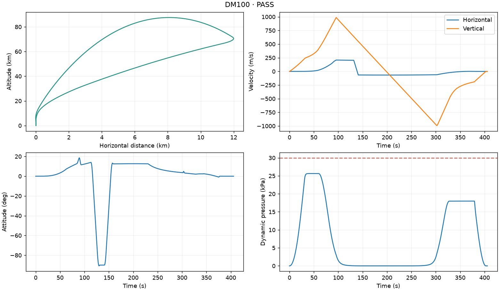

# DM100 - 2D Powered Landing Guidance

[한국어](README.ko.md) · [Model specification](docs/spec.md) · [Separation demo](docs/assets/flight.mp4)

A completed **2D concept-simulation project** for launching a 100 t rocket,
separating the upper stage and returning the first stage to its original pad.
It combines a custom rigid-body plant, model-based return guidance, PID-style
attitude feedback and a local, bilingual experiment interface.


## What the project delivers

- Launch, cold staging near 37 km, boostback, entry and first-foot touchdown.
- Variable mass, atmospheric flight, engine gimbal, RCS, fins and reduced-order
  feed, pressurization, slosh and separation models.
- Bounded weather and healthy-vehicle deviations, validated before calculation.
- Separate mission, flight-safety and landing assessments with graphs, measured
  results and explicit failed criteria.
- Optional MP4 replay from the saved flight, without running the simulation again.

Built with Python 3.12, NumPy/SciPy, FastAPI/Uvicorn, HTML/CSS/JavaScript and
Matplotlib/FFmpeg. No hosted service or frontend build toolchain is required.

This is a **software concept model**, not a qualified rocket or a certified flight
tool. Upper-stage delivery of a 500 kg payload to a theoretical 700 km circular
orbit is assumed, not simulated or verified. The linked video is a short
separation demonstration; a full replay can be generated in the local UI.

## Results

The final 100 t design passed **286 known-condition full-flight regression checks**:

| Test set | Passed / tested |
|---|---:|
| Development conditions | 205 / 205 |
| Previously observed evaluation conditions, reused for regression | 72 / 72 |
| Supplementary gust-exposure and half-step checks | 9 / 9 |

The primary 277 and supplementary nine checks have separate denominators. These
are not a fresh independent holdout and do not prove every continuous input
combination. Acceptance requires mission completion, flight safety, touchdown and
fuel-conservation checks together.

| Measurement across all 286 checks | Worst observed value | Requirement |
|---|---:|---:|
| Touchdown COM position error | 0.839 m | ≤2 m |
| Foot vertical / horizontal speed | 1.2551 / 0.202 m/s | ≤1.5 / ≤0.5 m/s |
| Touchdown tilt / angular rate | 0.0212° / 0.0226°/s | ≤3° / ≤0.5°/s |
| Peak dynamic pressure | 28.949 kPa | ≤30 kPa |
| Peak pre-contact angular acceleration | 3.780°/s² | ≤5°/s² |
| Minimum main / RCS propellant remaining | 2,958 / 95.875 kg | >0 / ≥0 kg |

Maxima are rounded upward and remaining propellant downward. The local UI was
also checked with one actual calm full flight and optional MP4 generation. That
flight reached first contact at **405.709 s**, with **1.005 m/s foot vertical
speed**, **5,796 kg main propellant** and **262.546 kg RCS propellant** remaining.
Software/API/browser checks are separate from the full-flight regression count.



The fixed regression inputs are tracked in
[configs/apr-regression-v1.json](configs/apr-regression-v1.json). Generated raw
campaigns and personal notes are excluded from Git; a fresh clone can rerun the
declared inputs without historical local files.

## Run on your computer

The verified development environment is **Windows with Python 3.12.7**. Python
3.12.x is required. From the repository directory:

```powershell
py -3.12 -m venv .venv
.\.venv\Scripts\python.exe -m pip install -e ".[ui,video]"
.\.venv\Scripts\python.exe -m powered_landing_guidance.local_app
```

After installation, Windows users can instead double-click
[launch-dm100.bat](launch-dm100.bat). Keep the terminal open while using the app;
press Ctrl+C to stop it. This is a Python-source application, not a standalone
executable. Additional operating systems need their own runtime and font checks.

The app opens a browser at `127.0.0.1` and selects a free local port. Calculations,
results and rendering stay on your computer. No cloud account, external API,
analytics or CDN is used at runtime; the initial package installation needs an
internet connection. English is the default and Korean is available in the UI.

1. Keep the calm defaults or enter values within the displayed ranges.
2. Run the flight. The app checks the complete input combination first.
3. Inspect success/failure, graphs, acceptance tables and failed criteria. A
   completed failed flight is distinct from an application execution error.
4. For a successful flight, optionally generate and download an MP4.

The vehicle, seed **378**, active fins and **0.01 s** integration step are fixed.
An eligible input does not guarantee flight success. Every result keeps its
original input snapshot; editing the form does not relabel an existing result.
Results are saved in the local user-data directory by default. To choose a folder:

```powershell
.\.venv\Scripts\python.exe -m powered_landing_guidance.local_app --output-dir artifacts/local-runs
```

### Video generation takes longer

**MP4 rendering is CPU-intensive and can take substantially longer than the flight
calculation.** A full recording contains thousands of frames; a higher resolution
adds work. There is no guaranteed completion time. Keep the app open while it
renders, and choose a short interval at 640 or 1280 pixels for a quick preview.
Video generation only renders the saved flight; it does not change its result.

## Vehicle and acceptance

| Item | Final design |
|---|---:|
| Launch / first-stage wet mass | 100,000 / 82,500 kg |
| First-stage dry mass, including fins and gear | 12,000 kg |
| First-stage main / RCS propellant | 70,200 / 300 kg |
| Upper dry mass / propellant / payload | 1,500 / 15,500 / 500 kg |
| First-stage sea-level / vacuum thrust | 1,600 / approximately 1,760 kN |
| First-stage sea-level / vacuum Isp | 300 / approximately 330 s |
| Initial thrust-to-weight ratio | Approximately 1.63 |
| Throttle / gimbal | Ideal continuous 0-100% / ±6° |
| Cold separation gate | 37 ±1 km; ≥20,000 kg main propellant |
| Recovery target | Original launch pad |

Landing is assessed at **first foot contact**: COM position error ≤2 m, foot
vertical/horizontal speed ≤1.5/0.5 m/s, tilt ≤3°, angular rate ≤0.5°/s, main
propellant >0 kg and RCS propellant ≥0 kg. Gear deployment, pad geometry and hull
clearance must also pass. Legs are assumed adequate below the vertical-speed
limit; contact strength and post-touchdown standing are not evaluated.

The [model specification](docs/spec.md) documents coordinates, all 19 states,
environment ranges, observation assumptions, conservation and safety limits.

## Reproduce and test

Run from the repository root with the installed virtual environment. Each flight
or campaign needs a **new output directory**; existing results are not overwritten.

```powershell
# Validate the example operating input without flying.
.\.venv\Scripts\python.exe -m scripts.run_nominal_flight --conditions configs/apr-operating-v1.yaml --check-inputs

# One calm launch-to-touchdown flight; saves result.json and trajectory.png.
.\.venv\Scripts\python.exe -m scripts.run_nominal_flight --output-dir artifacts/nominal --progress

# Validate/hash the tracked regression inputs, then run the 286 checks.
.\.venv\Scripts\python.exe -m scripts.evaluate_regression_suite --prepare --output-dir artifacts/regression
.\.venv\Scripts\python.exe -m scripts.evaluate_regression_suite --run all --workers 8 --output-dir artifacts/regression
```

The regression runner retains failed cases and execution errors. `--workers`
sets independent CPU processes; reduce it for a smaller computer. NumPy/SciPy
float64 is used; GPU acceleration is not implemented. Rerunning all flights is
substantially slower than validating inputs.

For a linked English/Korean report after those runs:

```powershell
.\.venv\Scripts\python.exe -m scripts.present_validation_results --campaign-dir artifacts/regression --nominal-result artifacts/nominal/result.json --out-dir artifacts/report --language both
```

Software tests cover physics, conservation, guidance, acceptance and the local
UI/API. These checks do not execute the 286-flight campaign:

```powershell
.\.venv\Scripts\python.exe -m pip install -e ".[ui,video,dev]"
.\.venv\Scripts\python.exe -m pytest -p no:cacheprovider
.\.venv\Scripts\python.exe -m ruff check --no-cache .
.\.venv\Scripts\python.exe -m ruff format --check --no-cache .
```

The v1.0.0 local verification passed **748 automated checks**, lint, formatting
and an installed-wheel check. The [Windows CI workflow](.github/workflows/checks.yml)
is configured to repeat the software checks and package build on pushes and pull
requests; it does not automatically rerun the 286-flight campaign.

## Repository structure

```text
.github/workflows/               Windows software checks and package build
configs/                         Operating inputs and fixed regression manifest
docs/                            Bilingual specification and curated demo assets
scripts/                         Flight, regression and results-report commands
src/powered_landing_guidance/     Plant, guidance, systems, local API/UI and replay
tests/                           Physics, conservation, protocol and UI/API tests
launch-dm100.bat                  Windows local-app launcher
```

`artifacts/` contains generated runs and `.local/` contains private notes; both
are Git-ignored. The repository includes only selected presentation media.

## Scope boundaries

The model has two translations and one planar rotation. Its components and
coefficients are theoretical assumptions, not measured or qualified hardware.
It does not resolve 3D flight, flexible structures, detailed fluid/thermal/plume
effects or leg/pad material strength. The upper-stage departure in the video is
an illustrative continuation, not an orbit solution. Exhaust hiding and the
held pose after contact are presentation effects, not engine-shutdown or stable-
standing dynamics. Finite synthetic success does not establish real-vehicle safety.
