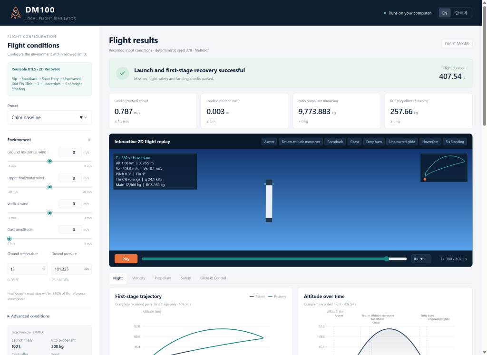
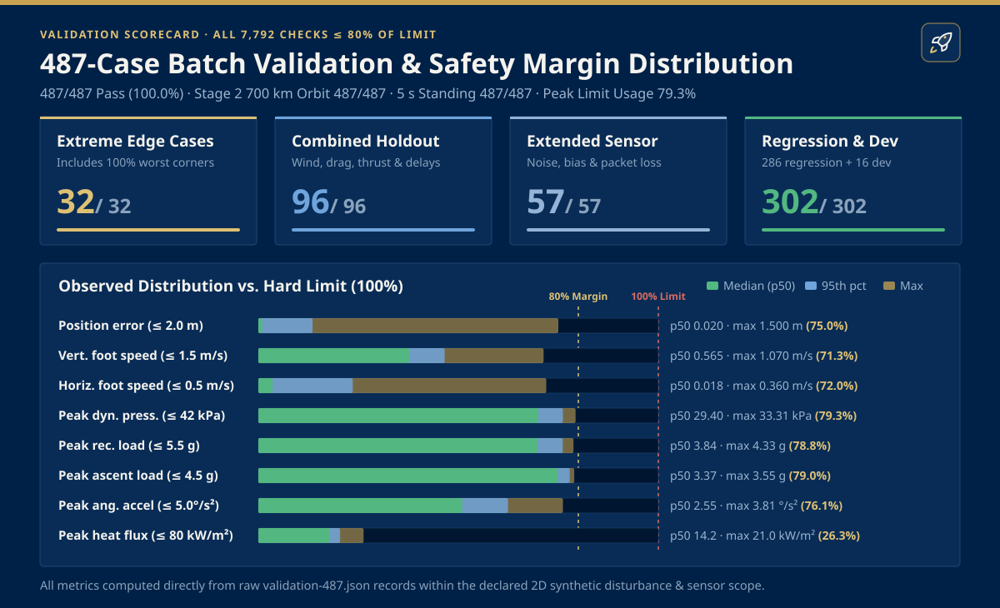
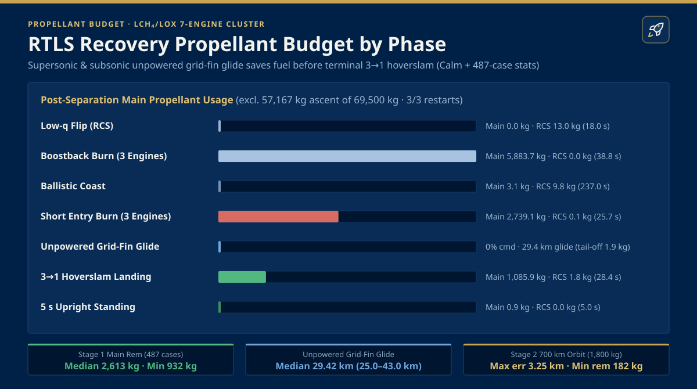
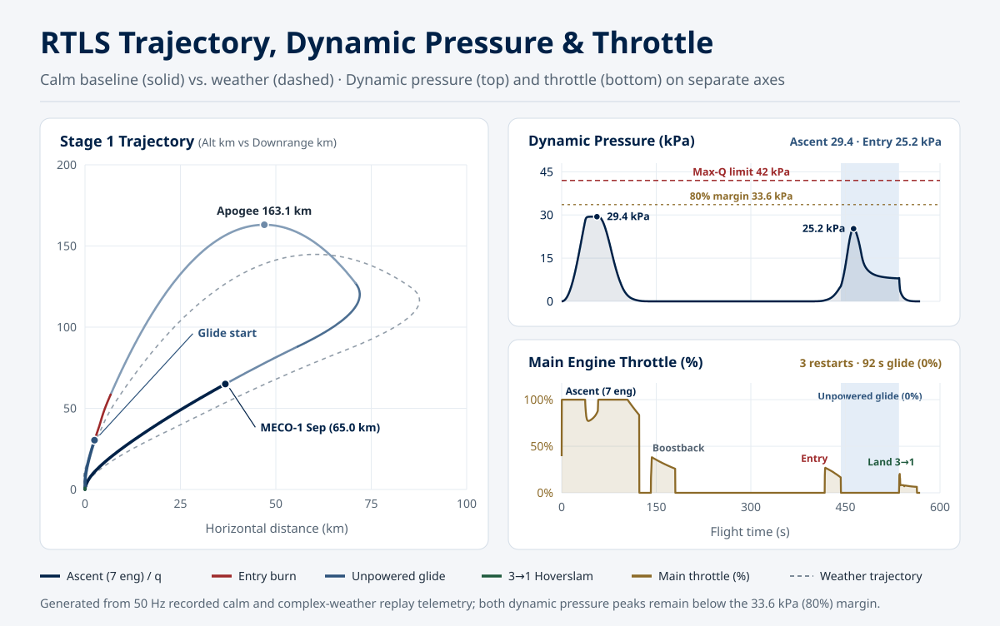

# DM100 · 100 t Methalox 700 km Orbital Launch & First Stage Reusable RTLS

[한국어](README.ko.md) | [Validation Results](docs/results.md) | [Model Specification](docs/spec.md) | [Validation Protocol](docs/validation.md) | [Roadmap (KO)](docs/roadmap.ko.md)

**DM100** is a **2D conceptual physics & GNC simulator** modeling a **100 t two stage Methalox (LCH₄/LOX) launch vehicle** that delivers a **1,800 kg payload to a 700 km circular orbit (LEO/SSO)** while recovering the first stage via **Return to Launch Site (RTLS)**.
After a 7 engine cluster ascent and high altitude cold stage separation, Stage 2 is propagated through a two burn spherical Earth transfer and apogee circularization into a 700 ± 15 km circular orbit, while Stage 1 executes a low q flip, 3 engine boostback, short entry burn (MECO 2), **25.0~43.0 km unpowered grid fin aerodynamic glide (0% throttle command)**, **3→1 minimum throttle hoverslam**, and **5 s post touchdown engine off landing leg contact & upright stability dynamics** inside a unified engine with a strict `Plant ↔ Forces ↔ GNC` boundary.

The offline local browser workbench defaults to English with instant Korean toggle, featuring an **interactive 2D realtime flight replay**, **50 Hz 3D replay JSON export (right handed ENU + unit quaternion `wxyz`)**, and optional H.264 MP4 video rendering.



## Implemented Physics, Guidance & Control

- **700 km Orbital Mission + 8 Phase RTLS Sequence**: `ascent → flip → boostback → coast → entry_burn → aero_glide → landing_burn → touchdown_settle`, coupled with a 2D spherical Earth two burn Stage 2 orbital integrator (`rtls/orbit.py`).
- **Coupled Vehicle Physics**: Variable mass & inertia, bluff body tail first descent drag ($C_{D,\text{descent}} = 1.65$), Sutton Graves stagnation heat flux ($\dot{q} \le 80\ \text{kW/m}^2$), supersonic/subsonic grid fin aerodynamics & hinge moment limits ($\le 7{,}500\ \text{N}\cdot\text{m}$), **7 engine Methalox cluster (36% per engine minimum throttle, max 3 restarts, 7→3→1)**, propellant feed buffer, closed helium pressurization, nonlinear slosh dynamics, momentum conserving cold separation, and **5 s spring damper + Coulomb friction landing leg contact dynamics**.
- **Strictly Causal Navigation & Attitude Estimation**: Noise, bias, observation/action delays, engine lag, and scheduled packet dropouts using only past observations (zero access to hidden plant truth).
- **Robust RTLS GNC (All 16 Constraints ≤ 80% of Limit)**:
  - `0.85 s` entry burn ignition throttle ramp with dual dynamic pressure & heat flux triggers (`26.5 kPa`, `62 kW/m²`) eliminating vacuum slosh torque shocks.
  - Supersonic high altitude (`z ≥ 27 km`) grid fin AoA cap (`5°`), low altitude (`z < 12 km`) high authority glide tracking, and causal online drag/density scale IIP estimation (`_predict_rtls_iip`).
  - Analytical zero tilt unwind predictor (`_predict_zero_tilt_state`) paired with low pass filtered horizontal acceleration bias (`bias_x`).
  - Smooth `0.28 s` angular acceleration ramp on vertical body entry, distance aware terminal horizontal braking, convex LP terminal reference planner, and priority control allocation (`grid fins → TVC gimbal → RCS`).
- **Stack**: Python 3.12, NumPy/SciPy, FastAPI/Uvicorn, HTML/CSS/JS, Matplotlib/FFmpeg. Uses explicit physics & GNC models (**no machine learning policies**).

## Full 487 Case Validation Campaign (All Constraints ≤ 79.3%)

Evaluated in a single parallel batch across **32 extreme boundary & 100% simultaneous worst case edge scenarios**, **169 validation study cases** (`configs/validation-study-v1.json`), and **286 regression cases** (`configs/apr-regression-v1.json`) ([validation-487.json](docs/results/validation-487.json), full report: [docs/results.md](docs/results.md)).

| Split | Passed / Run | Stage 1 Main Rem (kg) | Max Pos Error (m) | Max q (kPa) | Max Ang Accel (deg/s²) | Unpowered Glide (km) | 700 km Orbit / 5 s Standing |
|---|---:|---:|---:|---:|---:|---:|---:|
| Extreme edge cases (`edge-cases`) | **32 / 32 (100%)** | 1,749~3,692 | 0.389 | 33.31 | 3.81 | 25.0~32.3 | 32 / 32 · 32 / 32 |
| Development (`development`) | **16 / 16 (100%)** | 2,021~3,102 | 0.202 | 30.61 | 3.18 | 27.7~32.9 | 16 / 16 · 16 / 16 |
| Combined holdout (`holdout`) | **96 / 96 (100%)** | 1,822~3,146 | 0.901 | 32.24 | 3.15 | 27.3~35.7 | 96 / 96 · 96 / 96 |
| Extended sensor holdout (`sensor-holdout`) | **57 / 57 (100%)** | 1,817~3,099 | 0.279 | 31.21 | 3.19 | 26.7~35.3 | 57 / 57 · 57 / 57 |
| Regression suite (`regression`, 3 splits) | **286 / 286 (100%)** | 932~3,895 | 1.500 | 33.08 | 3.32 | 26.6~43.0 | 286 / 286 · 286 / 286 |
| **Total** | **487 / 487 (100.0%)** | **932~3,895** | **1.500** | **33.31** | **3.81** | **25.0~43.0** | **487 / 487 · 487 / 487** |

Across **7,792 individual constraint checks** (`16` metrics × `487` flights), **0 checks exceed 80%** of their limit (global peak utilization **`79.3%`**):
- **Stage 2 700 km Circular Orbit (1,800 kg)**: `700.01~703.25 km` (max `|Δh| = 3.25 km`, `21.7%` of `±15 km`), Stage 2 propellant remaining `182.2~918.7 kg`
- **Touchdown position error**: `0.000~1.500 m` (median **`0.020 m`**, **`75.0%`** of `2.0 m`)
- **Foot vertical / horizontal speed**: `0.078~1.070 m/s` (`71.3%`) / `0.000~0.360 m/s` (`72.0%`)
- **Touchdown tilt / angular rate**: `≤ 2.056°` (`68.5%`) / `≤ 0.301 deg/s` (`60.1%`)
- **Peak dynamic pressure / stagnation heat flux**: `≤ 33.31 kPa` (**`79.3%`** of `42 kPa`) / `≤ 21.05 kW/m²` (**`26.3%`** of `80 kW/m²`)
- **Peak ascent / recovery load**: `≤ 3.55 g` (`79.0%` of `4.5 g`) / `≤ 4.33 g` (`78.8%` of `5.5 g`)
- **Peak angular rate / acceleration / fin hinge**: `≤ 11.11 deg/s` (`74.1%`) / `≤ 3.81 deg/s²` (`76.1%`) / `≤ 1,397 N·m` (`18.6%`)
- **Stage 1 Main / RCS propellant remaining (median)**: **`2,612.8 kg`** (`min 932.0 kg`) / **`271.9 kg`** (`min 168.5 kg`, restarts `3/3`)
- **5 s engine off upright standing**: **487 / 487 (100.0%)** (`leg stroke ≤ 0.389 m` `43.3%`, `contact load ≤ 1.66 g` `41.4%`)







Reference 50 Hz 3D replay exports (`ENU` meters + unit quaternion `wxyz` for UE5/MuJoCo) are provided in [calm_replay_50hz.json](docs/results/replays/calm_replay_50hz.json) and [example_weather_replay_50hz.json](docs/results/replays/example_weather_replay_50hz.json).

## Local Offline Browser App

On Windows x64, clone or extract the repository and run [launch-dm100.bat](launch-dm100.bat). On Linux x64 (glibc ≥ 2.28), run `sh launch-dm100.sh`. If no suitable Python 3.12 is installed, the launcher provisions a local Python 3.12.15 and `.venv` automatically, then runs completely offline on `127.0.0.1` with zero external API or CDN calls. See [docs/runtime.md](docs/runtime.md) for platform details.

```bash
# Manual setup & launch
python3.12 -m venv .venv
.venv/bin/python -m pip install -c requirements/runtime-constraints.txt -e ".[ui,video]"
.venv/bin/python -m powered_landing_guidance.local_app
```

## CLI Flight & 487 Case Reproduction

```bash
# Single flight & 50 Hz 3D replay JSON export
python scripts/run_flight.py --scenario calm --export-replay artifacts/calm_replay_50hz.json
python scripts/run_flight.py --scenario example-weather --export-replay artifacts/example_weather_replay_50hz.json

# Fast 32 case extreme edge check or full 487 case parallel certification
python scripts/evaluate_validation.py --suite edge-cases --workers 8
python scripts/evaluate_validation.py --suite full-487 --workers 14 --out-json artifacts/validation-487.json
```

## Vehicle Parameters & Acceptance Criteria

| Parameter | Model Value |
|---|---:|
| Gross liftoff mass / Stage 1 initial mass | 100,000 / 76,000 kg |
| Stage 1 dry / main propellant (LCH₄·LOX) / RCS | 6,200 / 69,500 / 300 kg |
| Stage 2 dry / main propellant / payload | 1,550 / 20,650 / 1,800 kg |
| Stage 1 airframe (length / diameter) | 25.5 m / 3.1 m |
| Stage 1 7 engine cluster thrust (SL / vacuum) | 1,550 / 1,693 kN |
| Stage 1 Isp (SL / vacuum) | 325 / 355 s |
| Stage 2 vacuum thrust / Isp | 240 kN / 380 s |
| Throttle / restarts / gimbal | 36% min per engine (7→3→1) / max 3 restarts / ±6° |
| Stage 2 target orbit gate | 700 ± 15 km circular orbit (1,800 kg, rem prop > 0 kg) |
| Flight safety limits | q ≤ 42 kPa, q̇ ≤ 80 kW/m², ascent ≤ 4.5 g, rec ≤ 5.5 g, α̇ ≤ 5.0°/s², hinge ≤ 7,500 N·m |
| First touchdown acceptance | \|x\| ≤ 2.0 m, v_vert ≤ 1.5 m/s, v_horiz ≤ 0.5 m/s, tilt ≤ 3.0°, rate ≤ 0.5°/s |
| Post contact settling | 5 s engine off upright leg dynamics, stroke ≤ 0.90 m, load ≤ 4.0 g |

## Automated Software Verification

```bash
python -m pip install -c requirements/runtime-constraints.txt -e ".[ui,video,dev]"
python -m pytest -q -p no:cacheprovider
python -m ruff check --no-cache .
python -m ruff format --check --no-cache .
```

All **223 pytest tests (+ 11 subtests)**, `ruff check`, and `ruff format --check` pass cleanly across physics, conservation laws, 700 km orbital insertion, causal estimation, RTLS GNC, 50 Hz replay export, and the local web application.

## Scope & Limitations

DM100 is a 2D theoretical software simulator covering planar translation, pitch rotation, and spherical Earth 2D Stage 2 two burn orbital insertion. Coefficients are conceptual engineering assumptions rather than flight measured hardware tables. Structural flexibility, 3D aerodynamic plume CFD, material fatigue, 6DOF 3D flight, and real vehicle flight qualification are out of scope. 3D 6DOF MuJoCo physics and Unreal Engine 5 cinematic rendering are planned for a dedicated 3D repository ([docs/roadmap.ko.md](docs/roadmap.ko.md)).
