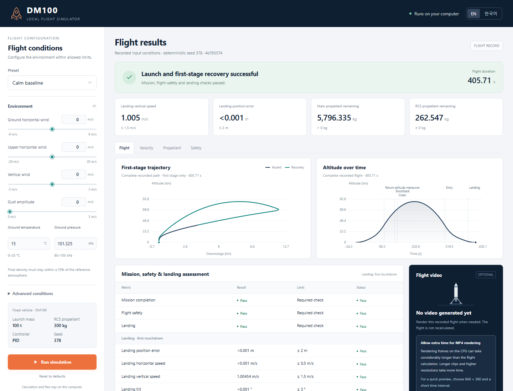

# DM100 - 2D Rocket Launch and Recovery

[한국어](README.ko.md) | [Recorded results](docs/results.md) | [Model specification](docs/spec.md)

A **2D concept simulator** for launching a 100 t rocket, separating its upper
stage near 37 km and returning the first stage to its original pad. A custom
19-state rigid-body and propulsion plant connects model-based return guidance,
PID-style attitude control, causal state estimation and first-contact acceptance.
The local experiment interface supports English and Korean.

To use the simulator, choose weather and vehicle conditions, run a flight, and
inspect its path, fuel use and landing checks. Stage separation detaches the lower
booster from the upper stage; the recovery calculation follows that booster back
to the launch pad.

Here, a **plant** is the simulated vehicle and its physics. Its state variables
describe quantities such as position, velocity, rotation and remaining propellant.
Guidance chooses the return path, while PID-style feedback control corrects the
difference between the desired and measured orientation. **Causal estimation**
uses measurements available so far,
rather than giving the controller future observations or the simulator's hidden
true state. **RCS**, the reaction control system, uses small thrusters to rotate
the vehicle; its consumption is the propellant those thrusters use.



## Implementation

- Launch, cold staging, boostback, atmospheric entry and first-foot touchdown.
- Variable mass and inertia, engine gimbal, RCS and fins, with reduced-order feed,
  pressurization, slosh and separation models.
- Causal navigation and attitude estimation under bounded noise, bias, latency
  and scheduled sensor packet omissions.
- Frozen evaluation inputs, paired feature ablations, full-flight step-size
  comparisons, parameter sensitivity and an independent integration reference.
- Public per-flight evidence, standard-library result validators, telemetry
  plots and optional MP4 replay from a saved trajectory.

Python 3.12, NumPy/SciPy, FastAPI/Uvicorn, HTML/CSS/JavaScript and
Matplotlib/FFmpeg. Guidance and estimation use explicit models; **this project
does not train a machine-learning policy**.

## Measured results

A passed flight meets the declared mission, safety, first-contact and propellant
criteria together. **Regression** checks repeat known inputs to see whether
working behavior is retained. **Coupled conditions** combine disturbances such as
wind, vehicle variation and delays. The sensor comparison runs each declared
condition with both measurement-processing methods, allowing their outcomes to
be compared on matching inputs.

| Evaluation population | Passed / attempted |
|---|---:|
| Known-condition regression | 286 / 286 |
| New coupled conditions | 96 / 96 |
| Extended sensors with estimator | 48 / 48 |
| Same sensors with raw angular processing | 48 / 48 |

For 48 matched pairs passing with both methods, median RCS consumption fell from 120.977 to 99.122 kg (18.07%).

The 286 known conditions measure regression. The 96 new coupled conditions and
48 extended-sensor conditions were evaluated after the implementation was frozen.
Each population has its own denominator. The paired sensor experiment compares
the same inputs and seeds; it does not compare different evaluation populations.
Sensor ranges are synthetic assumptions, not measured hardware specifications.

A **seed** fixes the starting point of a random-number generator, so the declared
noise sequences can be repeated. Freezing the implementation means recording the
version and settings before seeing the final outcomes. The **median** is the
middle value after sorting the measurements: lower RCS consumption indicates
less attitude-control propellant used in this comparison, not improvement in
every landing metric.

The [English report](docs/results.md) and [Korean report](docs/results.ko.md)
include touchdown measurements, finite-sample intervals, feature ablations,
numerical convergence and all failed outcomes. Success requires mission
completion, flight safety, first-contact acceptance and fuel conservation.


Check the published evidence without installing dependencies or rerunning flights:

```bash
python scripts/validate_evidence.py docs/results/validation-study-v1
python -m scripts.validate_regression_evidence docs/results/regression-v1.1
python -m scripts.check_source_binding docs/results/validation-study-v1/protocol.json docs/results/regression-v1.1/protocol.json docs/results/numerical-reference.json
```

These commands recompute aggregate values and check input, source and recorded
result consistency. They do not certify the authenticity of physical data.

## Run locally

Fresh installations were checked on **Windows with Python 3.12.7** and in a
**Linux container with Python 3.12.15**, on the same host. Each passed 787 software
tests and 11 subtests; one historical local-artifact test was skipped. This is
environment reproduction, not an independent third-party review. Detailed
versions and representative flight comparisons are in
[reproduction.json](docs/results/reproduction.json).

The runtime patch additionally checks managed Python 3.12.15 on Windows and Linux,
including automatic setup, Korean H.264 video, the real local UI and dependency
repair. See [runtime compatibility](docs/runtime.md) and its
[recorded checks](docs/results/runtime-compatibility.json).

On Windows x86-64, extract the source ZIP or clone the repository, then double-click
[launch-dm100.bat](launch-dm100.bat). The launcher uses an existing Python 3.12 or
downloads a project-local Python 3.12.15 automatically. It prepares a local `.venv`
with complete runtime constraints. First setup requires internet access. A healthy
environment is reused without reinstalling or accessing the network.
The browser opens at `127.0.0.1`; keep the terminal open and use Ctrl+C to stop.

```powershell
# Prepare the environment without opening the app.
.\launch-dm100.bat --setup-only
# Check the installed font and video encoder without starting the server.
.\launch-dm100.bat --doctor
```

The launcher checks an explicit
`DM100_PYTHON`, a working local environment, `py -3.12`, Python on `PATH`, and
repository-local Python when available, then prepares a managed runtime if needed.
An invalid explicit interpreter fails
with an explanation. After a folder move, it preserves a broken environment in
`.local/environment-backups/` and rebuilds for the current path.

Manual installation from the repository root:

```powershell
py -3.12 -m venv .venv
.\.venv\Scripts\python.exe -m pip install -c requirements/runtime-constraints.txt -e ".[ui,video]"
.\.venv\Scripts\python.exe -m powered_landing_guidance.local_app
```

On Linux x86-64 with glibc 2.28 or newer, use the same automatic setup:

```bash
sh launch-dm100.sh
sh launch-dm100.sh --setup-only
sh launch-dm100.sh --doctor
```

The first managed Python download needs curl or wget and standard tar/sha256sum.
Korean replay text uses the bundled Noto Sans KR font, with its OFL license. Video
uses the FFmpeg executable shipped with the tested video dependency; no system
font or FFmpeg installation is required. This is a Python-source application.
Do not distribute a copied `.venv`; the launchers construct it at the current path.

Calculations, saved results and rendering run locally. Runtime uses no external
API, account, analytics or CDN. English is the default interface language.

1. Keep calm defaults or enter eligible weather and healthy-vehicle deviations.
2. Run the flight and inspect mission, safety, touchdown and failed criteria.
3. Optionally render an MP4 from a successful saved trajectory.

An eligible input does not guarantee success. Execution errors are distinct from
completed failed flights. Editing the form never changes a recorded input snapshot.
The local UI retains its operating form; extended sensor settings and ablation
switches are configured through the study manifest or Python API.

Full MP4 generation is CPU-intensive and can take much longer than a flight.
Choose a short time interval for a quick replay. Rendering never reruns or changes
the numerical result. Watch the [full-flight video](https://drive.google.com/file/d/113QhNrm8Xrtc6MbekIDKgZg-NYdMrChc/view?usp=sharing)
from launch and stage separation through first-stage return and landing.

## Vehicle and acceptance

Wet mass includes propellant; dry mass excludes it. Isp (specific impulse)
describes thrust relative to propellant flow, while gimbal angle describes how
far the engine can tilt its thrust direction. Cold separation means the stages
separate without a continuing main-engine burn at the separation event. COM
means the vehicle's center of mass. These terms describe the simulated vehicle
and acceptance checks below.

| Item | Model value |
|---|---:|
| Launch / first-stage wet mass | 100,000 / 82,500 kg |
| First-stage dry / main / RCS mass | 12,000 / 70,200 / 300 kg |
| Upper dry / propellant / payload mass | 1,500 / 15,500 / 500 kg |
| Sea-level / vacuum thrust | 1,600 / approximately 1,760 kN |
| Sea-level / vacuum Isp | 300 / approximately 330 s |
| Throttle / gimbal | Ideal continuous 0-100% / ±6 degrees |
| Cold separation gate | 37 ±1 km; at least 20,000 kg main propellant |
| Recovery target | Original launch pad |

Landing is evaluated at **first foot contact**: COM position error at most 2 m,
foot vertical/horizontal speed at most 1.5/0.5 m/s, tilt at most 3 degrees,
angular rate at most 0.5 degrees/s, positive main propellant and nonnegative RCS
propellant. Gear deployment, pad geometry and hull clearance must also pass.
Leg adequacy below the vertical-speed limit is assumed. The model does not test
contact strength or post-touchdown standing.

The [model specification](docs/spec.md) documents coordinates, plant states,
operating ranges, conservation and limits. The [validation protocol](docs/validation.md)
defines the added sensor channels, estimator assumptions and experimental design.

## Reproduce a flight or the complete study

Use a new output file or directory. Existing evidence is never overwritten.

```bash
# One exact instrumented development case, including its original random streams.
python -m scripts.reproduce_case --job-id development/development-000/full/dt-0.01 --output artifacts/reproduced-case.json

# Independently integrate three smooth coupled-plant segments with SciPy DOP853.
python -m scripts.check_numerical_reference --output artifacts/numerical-reference.json

# Compare a newly reproduced case with its published result.
python -m scripts.verify_reproduction --evidence-dir docs/results/validation-study-v1 artifacts/reproduced-case.json

# Original 286 fixed regression inputs.
python -m scripts.evaluate_regression_suite --prepare --output-dir artifacts/regression
python -m scripts.evaluate_regression_suite --run all --workers 4 --output-dir artifacts/regression
```

The complete new study has **305 attempted flights**, including development,
paired sensor comparisons, ablations, convergence and sensitivity. See the
[study commands](docs/validation.md#reproduce) to prepare inputs, complete
development, freeze the source, execute each phase and export an evidence bundle.
The full regression and study together contain 591 attempts with separate purposes.
They are not 591 independent final-evaluation conditions.

Flights use CPU float64; no GPU implementation is provided. Full campaigns take
substantial time. Set `OPENBLAS_NUM_THREADS=1` and `OMP_NUM_THREADS=1` when using
multiple workers, and choose a worker count appropriate to your computer.

## Software checks

```bash
python -m pip install -c requirements/constraints.txt -e ".[ui,video,dev]"
python -m pytest -q -p no:cacheprovider
python -m ruff check --no-cache .
python -m ruff format --check --no-cache .
```

Tests cover plant dynamics, conservation, guidance, estimator causality,
acceptance, evidence tampering and the local API/UI. They are separate from
full-flight campaigns. The [Windows/Linux CI workflow](.github/workflows/checks.yml)
checks software, public evidence and packaging; it does not rerun every flight.

## Repository map

```text
configs/                         Fixed operating, regression and study inputs
docs/spec.md, spec.ko.md          Bilingual physical-model specification
docs/validation.md, validation.ko.md  Experimental design and reproduction
docs/results.md, results.ko.md    Generated numerical reports
docs/results/                    Curated per-flight evidence and environment results
docs/assets/                     Selected interface, trajectory, chart and demo assets
requirements/constraints.txt     Tested dependency constraints
scripts/                         Run, reproduce, validate and report commands
src/powered_landing_guidance/     Plant, guidance, estimation and local API/UI
tests/                           Software and evidence-integrity checks
launch-dm100.bat                  Windows environment and app launcher
```

Raw campaigns in `artifacts/`, environments, caches and personal working notes
are Git-ignored. Public documentation and curated validation evidence are tracked.

## Scope

This is a theoretical software concept model. It covers two translations and
one planar rotation; coefficients are assumed rather than calibrated to hardware.
Upper-stage delivery of a 500 kg payload to a 700 km circular orbit is assumed,
not simulated. Flexible structures, detailed fluid/thermal/plume effects,
leg/pad material strength, 3D flight and real-vehicle qualification are outside
the model. The upper-stage continuation and held pose in replay are visualization
effects. Finite synthetic success does not establish real-vehicle safety.
