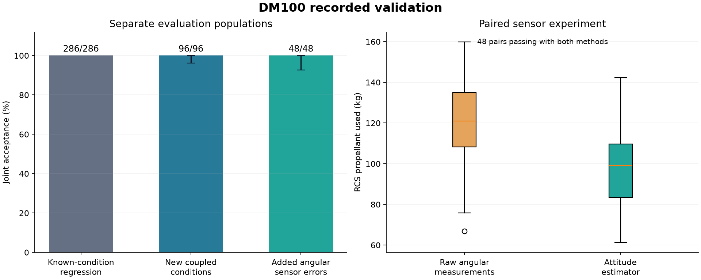

# 검증 결과

[English](results.md) | [검증 설계](validation.ko.md) | [공개 기록](results/validation-study-v1/)



| 평가 집단 | 통과 / 실행 |
|---|---:|
| 기존 조건의 회귀 검증 | 286 / 286 |
| 새로운 복합 조건 | 96 / 96 |
| 확장 센서 조건과 자세 필터 | 48 / 48 |
| 동일 센서 조건과 기존 계측 처리 | 48 / 48 |

각 집단은 별도 분모입니다. 기존 286개는 독립 평가가 아닙니다. 새 평가의 성공률도 선언한 합성 조건에 한정합니다. 서로 다른 집단의 최대 오차로 성능 개선율을 계산하지 않습니다.

새로운 조건: Wilson 95% 구간 96.15% ~ 100.00%.
확장 센서 조건: Wilson 95% 구간 92.59% ~ 100.00%.

## 착륙과 추진제 지표

| 항목 | 기존 286개 | 새로운 96개 | 센서 확장 48개 |
|---|---:|---:|---:|
| 최대 위치 오차 | 0.8384 m | 0.2604 m | 0.2081 m |
| 최대 수직 접지 속도 | 1.2551 m/s | 1.3047 m/s | 1.1285 m/s |
| 최대 수평 접지 속도 | 0.2010 m/s | 0.1900 m/s | 0.1929 m/s |
| 최대 동압 | 28948.2858 Pa | 26787.3503 Pa | 26715.0425 Pa |
| 주 추진제 최소 잔량 | 2958.1854 kg | 4584.8092 kg | 4587.6330 kg |
| RCS 추진제 최소 잔량 | 95.8752 kg | 165.2481 kg | 157.6098 kg |

실패 비행도 측정 가능한 지표에 포함합니다. 접지 지표의 측정 수는 공개 summary.json에 별도로 표시합니다.

## 같은 조건에서의 센서 처리 비교

두 방식 모두 성공한 동일 조건 48쌍에서 RCS 소모량 중앙값은 기존 계측 처리 120.977 kg에서 자세 추정기 99.122 kg으로 바뀌었습니다. 감소율은 18.07%입니다.
개별 쌍에서 소모량이 감소한 조건은 47개, 증가한 조건은 1개이며, 쌍별 절감량 중앙값은 24.836 kg입니다.

성공 여부는 전체 48쌍에서 비교하고, 추진제 효율은 두 방식 모두 기준을 충족한 쌍에서 비교합니다. 센서 오차는 모델 가정이며 실제 기체의 절감률이 아닙니다.

| 같은 48개 조건의 지표 | 기존 계측 처리 | 자세 추정기 |
|---|---:|---:|
| 위치 오차 95백분위 | 0.1287 m | 0.1569 m |
| 최대 수직 접지 속도 | 1.0929 m/s | 1.1285 m/s |
| 주 추진제 잔량 중앙값 | 5753.6334 kg | 5734.8544 kg |

자세 추정기는 이 조건에서 RCS 효율을 개선했지만 모든 접지 또는 추진제 지표를 개선하지는 않았습니다. 전체 성공률을 유지하면서 발생한 지표별 변화로 해석합니다.

## 개별 기능 제거 실험

| 기능 설정 | 통과 / 12개 |
|---|---:|
| full | 12 / 12 |
| raw-attitude | 12 / 12 |
| no-translation-bias | 11 / 12 |
| no-torque-bias | 11 / 12 |
| no-replanning | 10 / 12 |

## 수치 계산과 민감도

적분 간격 세 종류를 비교한 네 조건 중 성공 판정이 일치한 조건은 4/4개이며, 선언한 수치 허용오차를 모두 만족한 조건은 4/4개입니다.

가장 작은 적분 간격은 정확해가 아닌 비교 기준입니다. 개별 차이와 민감도 분석의 결과는 공개 analysis.json에 남겼습니다.

| 비교 지표 | 가장 작은 간격과의 최대 차이 | 사전 허용오차 |
|---|---:|---:|
| 접지 위치 | 1.82213e-05 m | 0.15 m |
| 수직 접지 속도 | 5.1751e-05 m/s | 0.08 m/s |
| 수평 접지 속도 | 3.99511e-05 m/s | 0.05 m/s |
| 비행 시간 | 0.000659708 s | 0.15 s |
| 주 추진제 잔량 | 0.0413377 kg | 40 kg |
| RCS 추진제 잔량 | 0.00489359 kg | 3 kg |
| 최대 동압 | 0.159042 Pa | 100 Pa |

매끄러운 세 구간의 RK4와 DOP853 비교는 3/3개를 통과했습니다. 최대 정규화 오차는 2.906e-10이며, 선언한 허용오차는 1e-7입니다. 이 값은 실물 기체의 정확도가 아닌 수치 적분기 간 차이입니다.

## 개별 매개변수 민감도

기준 조건과 추력 ±3%, 항력 ±15%, 관성 ±3%, 초기 질량 ±1% 조건은 9/9개를 통과했습니다. 아래 값은 다른 입력을 유지한 상태에서 기준 조건에 대한 차이입니다. 동시에 변하는 매개변수의 모든 조합을 검증한 결과는 아닙니다.

| 조건 | 통과 | 위치 오차 차이 (m) | 수직 접지 속도 차이 (m/s) | 주 추진제 잔량 차이 (kg) | RCS 잔량 차이 (kg) |
|---|---|---:|---:|---:|---:|
| calm-reference | True | +0 | +0 | +0 | +0 |
| sensitivity-drag_coefficient_scale-0.85 | True | +3.63209e-07 | +0.0003407 | -73.0449 | +1.07575 |
| sensitivity-drag_coefficient_scale-1.15 | True | -4.03428e-07 | -0.000355213 | +66.5353 | -0.414114 |
| sensitivity-inertia_scale-0.97 | True | +2.92066e-08 | +2.09827e-05 | -0.266326 | +0.65939 |
| sensitivity-inertia_scale-1.03 | True | -3.63331e-08 | -2.6124e-05 | +0.249987 | -0.660303 |
| sensitivity-initial_mass_scale-0.99 | True | -2.76544e-05 | +0.0131249 | +638.731 | +1.61838 |
| sensitivity-initial_mass_scale-1.01 | True | +3.00494e-05 | -0.0116883 | -634.438 | -0.464276 |
| sensitivity-thrust_scale-0.97 | True | +1.32166e-05 | -0.00537852 | -739.016 | +3.81547 |
| sensitivity-thrust_scale-1.03 | True | -1.39422e-05 | +0.00719164 | +713.848 | -1.08643 |

## 기록 검증

```bash
python scripts/validate_evidence.py docs/results/validation-study-v1
python -m scripts.validate_regression_evidence docs/results/regression-v1.1
```

두 검증기는 Python 표준 라이브러리만 사용하며 비행을 실행하지 않습니다. 저장된 결과의 일관성과 요약 수치를 확인합니다.
